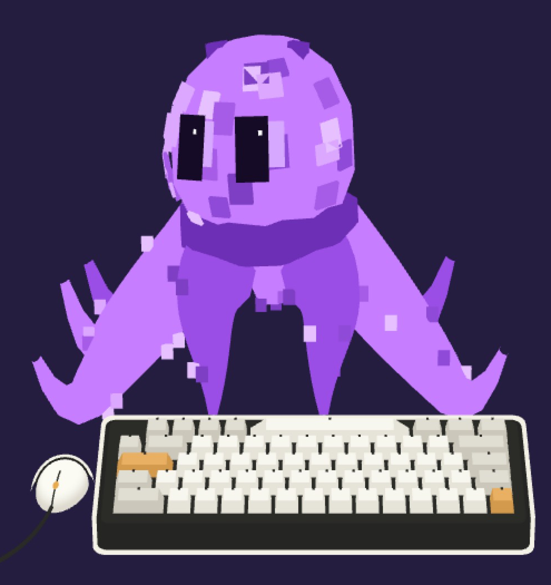

# KeyCat

> **本项目在开源版基础上加入了像素八爪鱼**：猫和八爪鱼可在菜单里随时切换，选择会被记住。原版功能全部保留，默认仍是猫。

三个版本，按需下载：

- **收费老祖版**：<https://xiaozhilittleone.com/zh/>
- **开源版（仅猫）**：<https://github.com/ElloboDK/KeyCat/releases/latest> · [下载页](https://ellobodk.github.io/KeyCat/)
- **八爪鱼版（本项目）**：<https://yellowsonpower.github.io/KeyCat/>（下载 Windows 安装包，另有在线演示）

一只趴在键盘上的桌面猫：你打字它伸爪按键，动鼠标它扭头看，摸头会闭眼，没人理会睡着，被烦到会用尾巴捶桌。支持 macOS 13+ 和 Windows 10+，除了从 GitHub 检查和下载更新，不联网。

开源版（猫）与八爪鱼版（像素八爪鱼）效果：

## 支持

如果觉得好玩，随意支持，一块钱也是心意（支付宝）：

## 说明

这是一个从零实现的学习项目，形象和交互参考了一款付费桌面宠物应用，仅供个人使用和内部交流，不用于商业分发，也不包含对方的任何素材。three.js 为 MIT 许可（见 `web/THREE_LICENSE`），Tauri 为 MIT / Apache-2.0 双许可。
